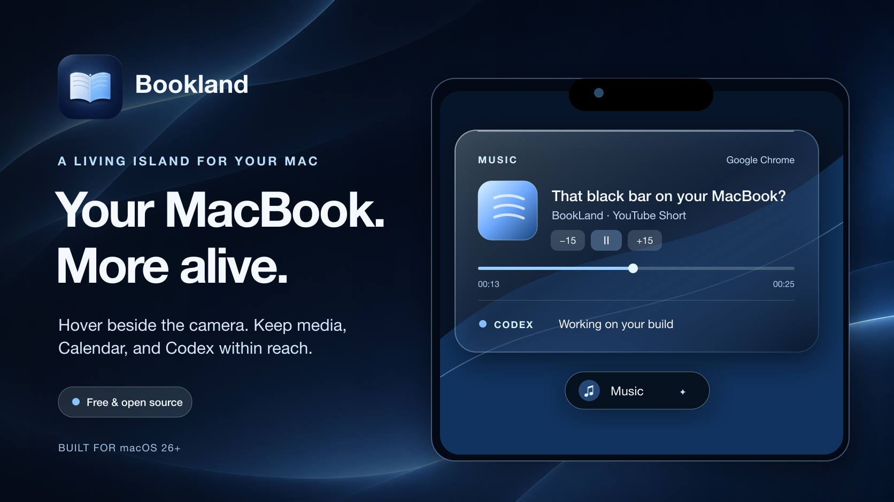

# Bookland

**A macOS hover island for media, everyday tools, and Codex.** Bookland lives at the top edge of the screen as a small black notch. Hover or click to open an adaptive Liquid Glass panel, choose a workspace in the floating pill, and move away to close it. The interface is in English and can display right-to-left music metadata, including Hebrew. Its original open-book mark appears in the app icon and island menu.

Bookland is an independent project inspired by the hover island in NotchNook. It is an early source release, not a copy of NotchNook's code or a claim that every original feature is complete. Bookland is not affiliated with NotchNook or OpenAI.

## What the island does

| Area | What is available |
| --- | --- |
| Hover shell | Closed top-edge strip, hover and click opening, close on pointer leave, workspace pill, touchpad scroll gestures, optional haptic feedback, configurable appearance and timing. |
| Nook | Media controls and artwork, selectable CPU/RAM/GPU/Battery/Disk Pulse cards, Pomodoro and stopwatch, To-dos, and optional widgets for notes, downloads, clipboard, weather, terminal, and camera mirror. |
| Music | Current macOS media session, including supported browser playback; Apple Music or Spotify can be selected as sources. There are playback controls, a seek bar, optional synced lyrics, Apple Music AirPlay output controls, system volume, and AirPods connection and battery readings when macOS reports them. Song and artist labels use bidirectional text ordering. |
| Calendar | Upcoming events and event creation through macOS EventKit after the user grants Calendar access. |
| Tray and Pocket | Recent files, a floating drag-and-drop Pocket, independent file copies, image conversion, AirDrop handoff, and user-initiated YouTube video downloads through yt-dlp. |
| Clipboard | Searchable text, link, color, image, and Finder-file cards with favorites and privacy controls. Optional local persistence excludes image payloads. |
| Agents | Recent local Codex, Claude Code, and optional external activity feed; task progress, usage information when available, and a compact decision view for Bookland-connected Codex turns. |
| Prompts and Prompter | An editable spreadsheet-chat prompt builder and a script prompter with scroll or voice-following modes. Both can be added to the island menu. |

The default Glass Nook is a single wide row. Music, Calendar, Tray, and the optional workspaces open as compact top-edge panels. The Agents hover panel uses a compact Progress/Usage layout. Its activity bubble opens the Codex app for ordinary desktop tasks; if a Bookland-connected turn asks for a decision, the bubble opens that request inside the same island. On Macs with a camera notch, the closed strip measures the cutout and leaves space for its status symbols on either side.

The closed activity ring runs in a macOS Core Animation layer so it moves between Bookland's low-frequency idle redraws. Opening and closing use a time-based spring with a 60 fps rendering cap during the brief transition; the shell morphs inside a stable host window and native glass is revealed as the panel expands. The closed shell has PNG-shaped rounded shoulders and a solid black center aligned with the physical camera cutout. The transparent host window adds no rectangular tint or outline.

### Codex inside the island

Bookland reads local Codex session activity for the hover panel. An optional in-island composer, reached through the prompt builder, can connect to a selected **desktop Codex thread** through the installed Codex app-server. It starts read-only. “Allow edits” enables workspace writes for that Bookland-connected turn; command, file, and additional-permission approvals, plus Codex questions, open a decision panel in the island as soon as they arrive. Only your explicit choice grants a requested permission, for that turn. Bookland saves the thread's prior approval and sandbox settings before changing them, then restores them when the turn ends or when recovery runs after an interrupted launch. A separate private Codex chat can be started from Bookland. The Codex app must be installed and signed in for these integrations. Bookland cannot yet receive or answer approval requests raised by turns already running in the Codex desktop app.

Bookland also accepts an optional local JSON feed from other tools. See [AGENT_FEED.md](AGENT_FEED.md) for the format. It shows brief activity labels and selected visible messages; it does not upload the session log to Bookland servers.

### Media and privacy

System media reads use Apple's private MediaRemote framework, and system playback controls use a bundled MediaRemote Adapter helper launched on demand. That path can change with macOS releases. Apple Music and Spotify actions use local automation. Lyrics lookup sends the playing song title and artist to LRCLIB only when synced lyrics are enabled. A video URL is sent to yt-dlp only after the user clicks Download. Codex uses the installed local Codex app and its configured service. Bookland has no separate cloud account or telemetry service.

Camera, microphone/speech, Calendar, and global shortcuts are opt-in. Clipboard history is kept in memory by default. If local clipboard persistence is enabled, text and Finder-file references are saved under `~/Library/Application Support/Bookland/`; image payloads stay in memory. Items that macOS or supported password managers mark as confidential or temporary are skipped. Untagged sensitive text cannot always be recognized, so the clipboard privacy controls should be used with care.

## Build and run

**Requirements:** macOS 26 or later, Xcode Command Line Tools, CMake, a current Rust toolchain, and an internet connection for the first build and the optional yt-dlp binary download. The project uses Rust, egui/eframe, wgpu/Metal, and small AppKit/Objective-C bridges.

```sh
git clone https://github.com/KyrocEU/bookland.git
cd bookland
cargo test
sh package.sh
open Bookland.app
```

`package.sh` downloads the official yt-dlp macOS executable only if it is missing, verifies its SHA-256 hash, builds the Release app and bundled MediaRemote Adapter, and applies a local ad-hoc signature. This source build is **not notarized**. If macOS blocks it on first launch, inspect the standard macOS Open Anyway flow for locally built apps. The app is a menu-bar-style utility (`LSUIElement`) and draws its window at the screen's top edge rather than opening a normal Dock window.

To keep Bookland running after login, enable **Settings → General → Launch at login**. To tune hover behavior, use **Settings → Behavior → Close after the pointer leaves** and its delay slider. The default delay is 550 ms after leaving the island. Right-click the closed strip for Open Nook, Pocket, workspace editing, and Settings.

## Source map

- `src/main.rs`: island state, views, settings, rendering, and event loop.
- `src/glass.m`, `src/pocket_drag.m`, `src/island_gesture.rs`: native glass host, pointer tracking, and gestures.
- `src/agents.rs`, `src/codex_desktop.rs`, `src/codex_bridge.rs`: local activity and Codex connections.
- `src/now_playing.jxa`, `src/media_remote_adapter.rs`, `src/music_airplay.rs`, `src/lyrics.rs`, `src/airpods.rs`: media and accessories.
- `src/calendar.m`, `src/clipboard.m`, `src/mirror.m`, `src/prompter_speech.m`: macOS integrations.
- `src/pocket.rs`, `src/video.rs`, `src/downloads.rs`: file and download tools.
- `Info.plist`, `build.rs`, `package.sh`: app metadata, native compilation, and packaging.

See [THIRD_PARTY.md](THIRD_PARTY.md), [vendor/README.md](vendor/README.md), and [assets/README.md](assets/README.md) for dependency and asset provenance. The OpenAI mark in `assets/` identifies Codex activity and is not covered by the code's MIT license.

The editable Bookland logo, app icon, banner, and GitHub social preview are in [assets/brand](assets/brand/README.md). The icon is included in `Bookland.app` when packaged.

## Current limits

This is a working preview with gaps. AirPlay route changes, real AirPods battery display, physical trackpad haptics, live microphone-following, and some permission-dependent flows have not been verified end to end on every Mac. The hover island and major workspaces have been exercised in the signed app, but macOS 26 compatibility and use of private media APIs can vary by system version. Open issues or contribute test results with the exact macOS version and hardware model.

## License

The original Bookland source is MIT licensed; see [LICENSE](LICENSE). Third-party code, the yt-dlp executable, and the OpenAI mark retain their own terms as described in the notices above.
